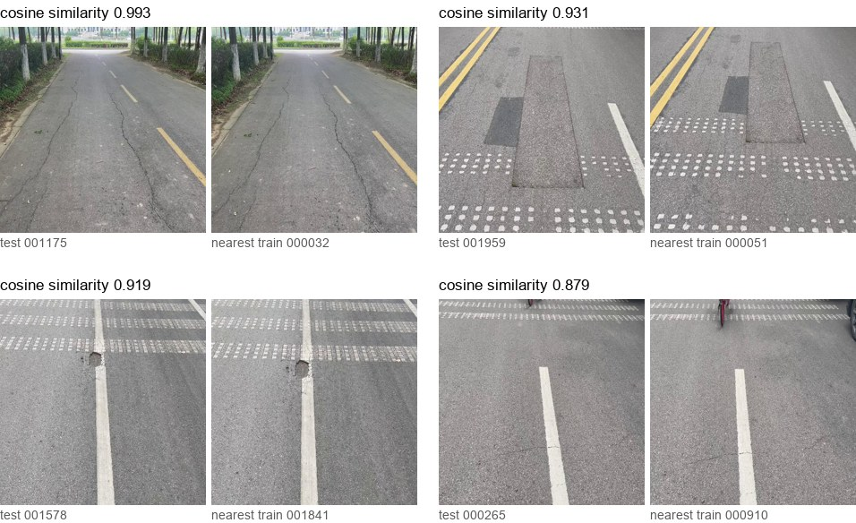

# Road Damage Detection

[](https://github.com/Zeta-12/road-damage-detection/actions/workflows/ci.yml)

Detection of cracks and potholes in images taken from vehicles, on the RDD2022 dataset (Japan, India, Norway, United
States, Czech Republic, China). I compare a CNN detector (YOLO) with a transformer detector (RT-DETR), measure how a
model trained in some countries works in the others, and deploy the best one on an edge device (OpenVINO, INT8, C++).

Status: first results with YOLO26s on all countries (below), RT-DETR-L training.

## Dataset

| Class | Damage |
|---|---|
| D00 | longitudinal crack |
| D10 | transverse crack |
| D20 | alligator crack |
| D40 | pothole |

Labelled images and boxes kept (output of `rdd prepare`):

| Subset | Images | No damage | D00 | D10 | D20 | D40 | Image size |
|---|---|---|---|---|---|---|---|
| Japan | 10506 | 2606 | 4049 | 3979 | 6198 | 2243 | 600x600 (97 %) |
| India | 7706 | 4483 | 1555 | 68 | 2021 | 3187 | 720x720 |
| Norway | 8161 | 5247 | 8570 | 1730 | 468 | 461 | 3643x2041 to 4040x2035 |
| United_States | 4805 | 0 | 6750 | 3295 | 834 | 135 | 640x640 |
| Czech | 2829 | 1757 | 988 | 399 | 161 | 197 | 600x600 |
| China_MotorBike | 1977 | 43 | 2678 | 1096 | 641 | 235 | 512x512 |
| China_Drone | 2401 | 482 | 1426 | 1263 | 293 | 86 | 512x512 |
| **total** | 38385 | 14618 | 26016 | 11830 | 10616 | 6544 | |

- As in the challenge, only the 4 classes are kept. The 10705 boxes with other labels are dropped, mostly in Japan:
  blurred crosswalks and white lines (D43, D44), manholes (D50), repairs and a few rare classes.
- The subsets are very different: no image without damage in the United States, few transverse cracks in India,
  drone views for China_Drone. Norway images are 6x wider than the others: resized to 640 px for training, a crack
  5 px wide becomes less than 1 px.

The images of the official challenge test set have no labels, so I split the labelled `train` folders of each
subset into train / val / test (70 / 10 / 20, seed 42). I first wrote a split by blocks of consecutive images, in
case the numbering followed the capture order: consecutive frames of a drive are near-duplicates and would leak
between train and test. `rdd stats --sequences` compares 32x32 thumbnails of consecutive images and of random pairs.
The ratio of the mean differences is between 0.96 and 1.04 in every subset, so the numbering is shuffled and the
split is random per image (`block_size: 1`). Near-duplicates that are not neighbours in the numbering are still
possible, they are measured in [Results](#results).

## Results

### YOLO26s on all countries

YOLO26s fine-tuned from the COCO weights on the 7 subsets together: 640 px, batch 16, 100 epochs, 8.2 h on an
RTX 3060 Ti (8 GB). With `optimizer=auto` Ultralytics picks MuSGD at lr 0.01. `best.pt` is epoch 70 (best val
fitness, mAP50 0.607 and mAP50-95 0.314 on val).

Test split (`rdd evaluate`):

| Test set | Images | mAP50 | mAP50-95 | Recall | AP50 D00 | AP50 D10 | AP50 D20 | AP50 D40 |
|---|---|---|---|---|---|---|---|---|
| all | 7676 | 0.600 | 0.311 | 0.556 | 0.603 | 0.580 | 0.710 | 0.508 |
| Japan | 2101 | 0.579 | 0.278 | 0.562 | 0.509 | 0.489 | 0.732 | 0.586 |
| India | 1541 | 0.401 | 0.190 | 0.394 | 0.384 | 0.097 | 0.678 | 0.445 |
| Norway | 1632 | 0.291 | 0.125 | 0.299 | 0.382 | 0.259 | 0.333 | 0.191 |
| United_States | 961 | 0.653 | 0.384 | 0.623 | 0.792 | 0.677 | 0.741 | 0.403 |
| Czech | 566 | 0.410 | 0.160 | 0.452 | 0.466 | 0.334 | 0.524 | 0.314 |
| China_MotorBike | 395 | 0.927 | 0.580 | 0.872 | 0.915 | 0.866 | 0.943 | 0.985 |
| China_Drone | 480 | 0.701 | 0.398 | 0.687 | 0.768 | 0.812 | 0.398 | 0.826 |

1. **The subset matters much more than the class: 0.29 mAP50 in Norway, 0.93 in China_MotorBike.** Points 2 and 3
   explain part of it. Some AP50 values rest on very few boxes: India has 13 D10 boxes in test, the United States
   24 D40 boxes.

2. **There are near-duplicates between train and test, a lot in China_MotorBike.** `rdd duplicates` embeds every
   image with an ImageNet ResNet-50 and finds the nearest train image of each val / test image (cosine similarity).
   Looking at the pairs, most of them are the same place from 0.96 up, in every subset. In China_MotorBike the same
   damage was photographed several times and the copies go further down, the 0.879 pair below is the same crack with
   the same bicycle at the top:

   

   mAP50 on the test images with and without a near copy in train (`rdd evaluate --similarity 0.96 1.01`, then
   `--similarity 0 0.96`):

   | Test set | Images >= 0.96 | mAP50 | Images < 0.96 | mAP50 |
   |---|---|---|---|---|
   | all | 1066 | 0.735 | 6610 | 0.579 |
   | Japan | 30 | 0.818 | 2071 | 0.575 |
   | India | 45 | 0.499 | 1496 | 0.401 |
   | Norway | 589 | 0.249 | 1043 | 0.315 |
   | United_States | 56 | 0.775 | 905 | 0.649 |
   | Czech | 13 | 0.497 | 553 | 0.410 |
   | China_MotorBike | 300 | 0.931 | 95 | 0.891 |
   | China_Drone | 33 | 0.960 | 447 | 0.681 |

   - Without them the overall mAP50 goes from 0.600 to 0.579. Japan, India, the United States and Czech hardly move.
   - 300 of the 395 China_MotorBike test images are above 0.96 and the 95 others still include copies. Its 0.927
     says more about memorisation than about detection, I don't use it to compare models.
   - Norway goes the other way (0.249 with a near copy, 0.315 without). Many of its near copies are the same road a
     few metres further, but at 640 px the cracks are too small for the copy to help (point 3).

   A test set without leaks needs a split by groups of near-duplicates (see [Plan](#plan)).

3. **Norway is limited by the input size.** Its images are 3643 to 4040 px wide and 640 px divides them by 6. Same
   weights, Norway test only, larger inference size (`rdd evaluate --countries Norway --imgsz 1280`):

   | Inference size | 640 | 1280 | 1920 |
   |---|---|---|---|
   | Norway mAP50 | 0.291 | 0.364 | 0.325 |
   | Norway recall | 0.299 | 0.379 | 0.350 |

   1920 loses part of the gain, probably because the objects are then far from the sizes seen in training at 640.
   Next step: train at 1280, or on tiles.

4. **Training longer did not help.** The val losses stop going down after epoch 50 to 70, val mAP50 peaks at 0.607
   around epoch 70 and ends at 0.593 at epoch 100. Turning mosaic off for the last 10 epochs (Ultralytics default)
   made the train loss drop and the val mAP go down further. The next runs use fewer epochs.

5. **Classes are rarely confused with each other.** In the confusion matrix of the test set, at most 7 % of the boxes
   of a class are predicted as another class (D20 as D00). The errors are missed damage and detections on intact road,
   half of these false detections are D00.

## Plan

- [x] YOLO26s on all countries, mAP per country
- [ ] RT-DETR-L on all countries (training, `configs/rtdetr.yaml`: 40 epochs, AdamW lr 1e-4)
- [x] Near-duplicates between train and test
- [ ] Split by groups of near-duplicates and retrain, for a test set without leaks
- [ ] Norway at 1280 px (training at that size, or tiles)
- [ ] Cross-country: train on one subset, test on the others
- [ ] OpenVINO FP16 / INT8 (post-training quantization, then quantization-aware training if needed), latency and mAP
  on CPU / iGPU / NPU
- [ ] C++ inference app with OpenVINO

## Quickstart

Requires Python 3.11 to 3.13 and [uv](https://docs.astral.sh/uv/).

```bash
git clone https://github.com/Zeta-12/road-damage-detection.git
cd road-damage-detection
uv sync                       # CPU wheels

uv run rdd download           # RDD2022, 13.3 GB, CC BY 4.0, into datasets/RDD2022
uv run rdd prepare            # YOLO labels, split, dataset files in datasets/RDD2022/yolo/
uv run rdd stats --sequences  # images and boxes per country, consecutive image check
uv run rdd train --model yolo26s.pt
uv run rdd evaluate --weights runs/yolo26s_all/weights/best.pt
uv run rdd duplicates         # nearest train image of every val / test image
uv run rdd evaluate --weights runs/yolo26s_all/weights/best.pt --similarity 0 0.96
uv run rdd train --config configs/rtdetr.yaml
```

On an NVIDIA GPU, replace the CPU wheels with the CUDA build that matches your driver, then use `--no-sync` so uv
does not put the CPU wheels back:

```bash
uv pip install --reinstall torch torchvision --index-url https://download.pytorch.org/whl/cu134
uv run --no-sync rdd train --model yolo26s.pt
```

## Repository layout

```
src/road_damage/
  data.py        download, VOC to YOLO labels, block split per country, dataset files, stats
  train.py       Ultralytics training, mAP per country
  duplicates.py  nearest train image of every val / test image (ResNet-50 embeddings)
  config.py      defaults and YAML overrides
  cli.py         `rdd` command
tests/           unit tests on a small synthetic dataset in RDD2022 layout, and a 1-epoch end-to-end run
configs/         default.yaml with all the parameters, rtdetr.yaml
```

## Dataset and licence

[RDD2022](https://doi.org/10.6084/m9.figshare.21431547) (Arya et al., [arXiv:2209.08538](https://arxiv.org/abs/2209.08538))
is distributed under CC BY 4.0 and is not included in this repository. `rdd download` fetches it from figshare and
checks the MD5. The 8 photos in `docs/assets/china_motorbike_pairs.jpg` come from RDD2022.

Code: AGPL-3.0, because it uses [Ultralytics](https://github.com/ultralytics/ultralytics) (AGPL-3.0).

## Author

**Julien Beloin**, Machine Learning & Computer Vision Engineer
([LinkedIn](https://www.linkedin.com/in/j-beloin), [GitHub](https://github.com/Zeta-12))
